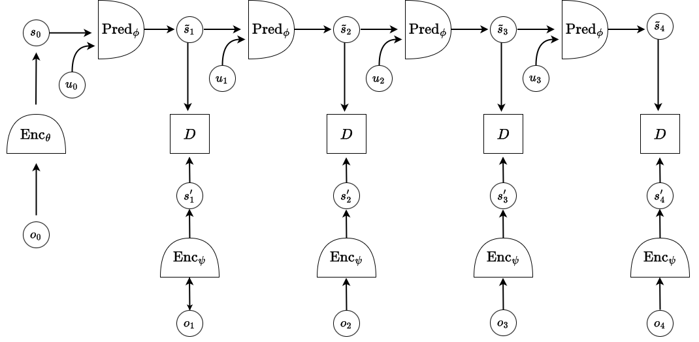
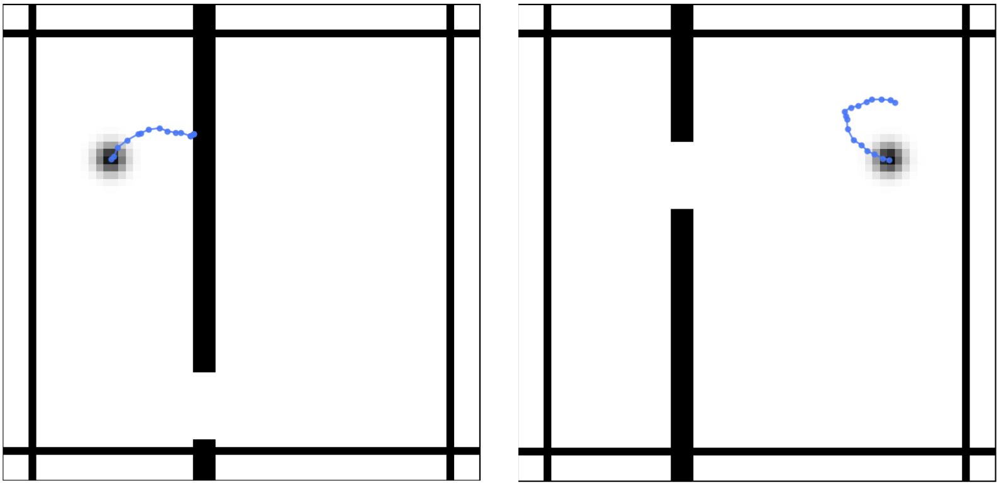

# NYU DL Course Competition: JEPA World Model (Team 19)

Final project for **CSCI-GA 2572 Deep Learning (Spring 2025), NYU**. We train a **Joint Embedding Predictive Architecture (JEPA)** world model on pre-collected trajectories of an agent moving through a two-room environment. The model predicts its own *latent representations* of future observations from an initial frame and an action sequence. No pixel reconstruction is used.

**Team 19:** Akshat Tulsani · Rivujit Das · Anurup Naskar

---

## Results

The model is evaluated by training a 2-layer MLP prober to recover the agent's true $(x, y)$ position from the **predicted** representations. Scores are MSE in pixel units; lower is better.

| Validation set | What it tests | MSE ↓ |
|---|---|---|
| `probe_normal` | Trajectories similar to the training distribution | **2.036** |
| `probe_wall` | Agent runs straight into the wall or door (stopping dynamics) | **5.650** |
| `probe_wall_other` | Out-of-domain wall positions not seen in training | **6.919** |
| `probe_expert` | Long-horizon expert trajectories | **7.305** |

**Trainable parameters:** 1,885,632

These numbers are recorded in [`metrics.txt`](metrics.txt).

---

## Approach

### Architecture

```
o_0 ──► Encoder ──► s_0 ─┐
                         ├─► Predictor(GRU) ──► s̃_1 ─┐
                  u_0 ───┘                            ├─► Predictor ──► s̃_2 ──► … ──► s̃_N
                                              u_1 ───┘
```

**Encoder (dual-stream CNN), `models.py`**
- The 2-channel 64×64 observation is split. Channel 0 (agent) and channel 1 (walls/border) each go through their own CNN stream.
- Each stream has 4 × [Conv3×3 → ReLU → MaxPool2] layers (16→32→64→128 channels, 64×64 → 4×4), then Flatten → Linear(2048, 256) → ReLU.
- The two 256-d features are concatenated and projected by Linear(512, 256) → BatchNorm to give a **256-d representation**.
- Separate streams let the model learn agent position and room layout (wall and door placement) independently before fusing them.

**Predictor (action-conditioned GRU), `models.py`**
- The action $(\Delta x, \Delta y)$ is embedded by Linear(2, 64) → ReLU.
- `[state_repr ‖ action_embed]` goes through a single-step GRU (hidden size 256), then Linear(256, 256) → BatchNorm.
- At both training and inference time the predictor is **unrolled recurrently**: each prediction $\tilde{s}_n$ is fed back as the input for step $n+1$.

### Training objective: VICReg, `train.py`

At every timestep $t = 1 \dots T-1$, the recurrently predicted representation $\tilde{s}_t$ is matched against the encoder's embedding of the true frame $s_t = \text{Enc}(o_t)$. The encoder is shared, so there is no separate target network. Collapse is prevented with a [VICReg](https://arxiv.org/abs/2105.04906) loss:

$$
\mathcal{L} = 25\cdot\underbrace{\text{MSE}(\tilde{s}_t, s_t)}_{\text{invariance}} + 25\cdot\underbrace{\big[\text{ReLU}(1-\sigma(\tilde{s}_t)) + \text{ReLU}(1-\sigma(s_t))\big]}_{\text{variance}} + 1\cdot\underbrace{\big[c(\tilde{s}_t) + c(s_t)\big]}_{\text{covariance}}
$$

Here $c(\cdot)$ is the sum of squared off-diagonal covariance entries divided by the dimension. The loss is averaged over timesteps.

| Hyperparameter | Value |
|---|---|
| Representation dim | 256 |
| GRU hidden dim | 256 |
| Batch size | 64 |
| Optimizer | Adam, lr = 1e-3 |
| Epochs | 40 |
| VICReg weights (sim / var / cov) | 25 / 25 / 1 |

Checkpoints are saved every 10 epochs (`jepa_checkpoint_epoch_{N}.pt`), and the final weights go to `jepa_final_model.pt`.

---

## Repository structure

| File | Description |
|---|---|
| `models.py` | `Encoder`, `Predictor`, `JEPAModel`, plus the `Prober` and `MockModel` from the course template |
| `train.py` | VICReg JEPA training loop (`python train.py`) |
| `main.py` | Loads `model_weights.pt` and runs probing evaluation on all validation sets |
| `evaluator.py` | `ProbingEvaluator`: trains the prober on predicted embeddings and reports MSE |
| `dataset.py` | `WallDataset` and dataloader for `states.npy`, `actions.npy`, `locations.npy` |
| `normalizer.py` | Location normalization stats used by the prober |
| `schedulers.py` | Cosine learning-rate schedule with warmup, used by the prober |
| `configs.py` | Dataclass and OmegaConf config helpers |
| `model_weights.pt` | Trained weights of the submitted model (~7.5 MB) |
| `metrics.txt` | Final evaluation results |
| `team_name.txt` | Team members |
| `assets/` | Figures from the original project description |

---

## Getting started

### Requirements

- Python 3.8+
- PyTorch with CUDA. The evaluator calls `.cuda()`, so a GPU is required for evaluation.
- Other dependencies:

```bash
pip install -r requirements.txt   # matplotlib, numpy, omegaconf, tqdm
pip install torch                 # pick the build matching your CUDA version
```

### Data

The dataset was distributed on NYU HPC under `/scratch/DL25SP/`:

```
/scratch/DL25SP/
├── train/                 states.npy (N, T, 2, 64, 64), actions.npy (N, T-1, 2)
├── probe_normal/{train,val}/
├── probe_wall/val/
├── probe_wall_other/val/
└── probe_expert/{train,val}/
```

- **States** are 2-channel 64×64 images. Channel 0 is the agent and channel 1 is the border and walls.
- **Actions** are $(\Delta x, \Delta y)$ displacements.
- **Locations** (probing sets only) are the ground-truth agent $(x, y)$ coordinates.

If your data lives somewhere else, edit `data_path` in `train.py` and `main.py`.

### Train

```bash
python train.py
```

### Evaluate

```bash
python main.py
```

This prints the parameter count and the probing MSE for `normal`, `wall`, `wall_other` and `expert`.

---

## Background: the competition task

<details>
<summary>Original project description (click to expand)</summary>

### JEPA

JEPA ([LeCun, 2022](https://openreview.net/pdf?id=BZ5a1r-kVsf)) is an energy-based self-supervised architecture that learns by predicting its own representations of future observations. Given a trajectory $\tau = (o_0, u_0, o_1, u_1, \ldots, o_N)$, a recurrent JEPA is defined as:

$$
\text{Encoder}: \tilde{s}_0 = s_0 = \text{Enc}_\theta(o_0), \qquad \text{Predictor}: \tilde{s}_n = \text{Pred}_\phi(\tilde{s}_{n-1}, u_{n-1})
$$

Training minimizes the energy $F(\tau) = \sum_{n=1}^{N} D(\tilde{s}_n, s'_n)$, where $s'_n$ comes from a target encoder. Collapse has to be prevented with regularizers (VICReg, Barlow Twins), contrastive samples, or architectural choices such as BYOL.



### Environment

An agent (dot) moves through two rooms separated by a wall that has a door. Wall and door positions vary across trajectories, so the model has to perceive the layout.



### Constraints

- The model must be a JEPA trained in representation space, with collapse prevented.
- **No image reconstruction** objectives (e.g. MAE).
- Only the provided training data may be used. Augmentation is allowed.

### Evaluation and scoring

The JEPA is unrolled from $o_0$ and the action sequence. A 2-layer prober is trained on `probe_normal/train` and evaluated on held-out sets. Teams were ranked on:

1. MSE on `probe_normal`
2. MSE on `probe_wall`
3. MSE on the long-horizon (expert) probe
4. MSE on the out-of-domain wall probe
5. Parameter count (fewer is better)

</details>

---

## Acknowledgements

Starter code (evaluator, dataset, scheduler and config utilities) was provided by the CSCI-GA 2572 course staff at NYU. Collapse prevention follows VICReg ([Bardes, Ponce & LeCun, 2022](https://arxiv.org/abs/2105.04906)).
